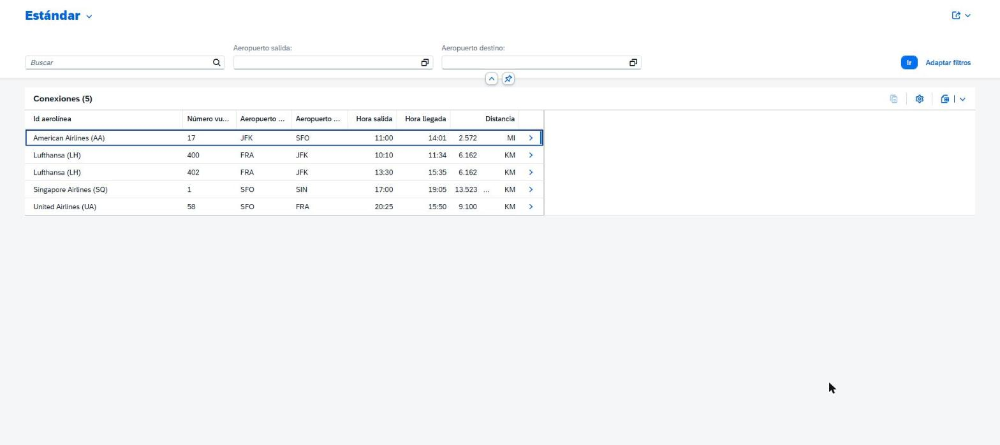
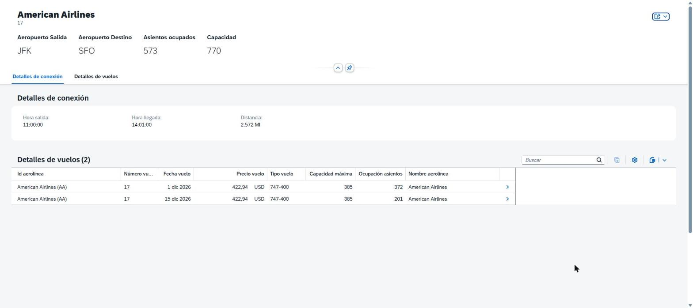
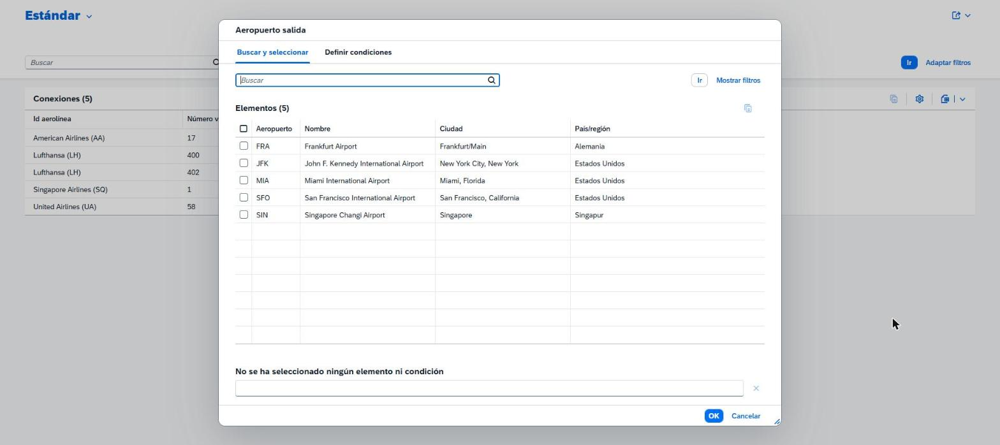
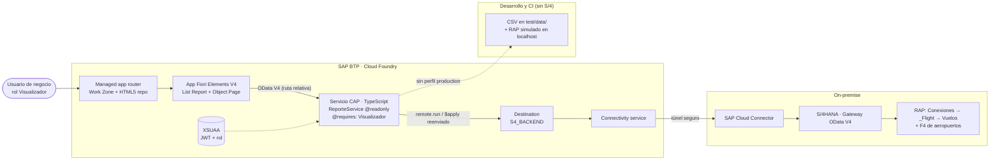

# reporte-simple

[](https://github.com/pgj1010/reporte-simple/actions/workflows/test.yml)


**[English version](README.md)**

Reporte **Fiori Elements** de solo lectura sobre **SAP BTP** que lee en vivo un servicio **RAP (OData V4)** de un **S/4HANA on‑premise**, construido con **SAP CAP en TypeScript**. Además de ser un reporte, sirve como **base reutilizable** para los siguientes: reglas verificadas por tests, decisiones documentadas y lecciones aprendidas.

> Todo el proyecto, desde el análisis del servicio hasta el despliegue en Cloud Foundry, se construyó junto a **Claude Code**, con un proceso explícito de reglas, planes por etapa y aprobaciones. Ver [Cómo lo construí con Claude Code](#cómo-lo-construí-con-claude-code).

---

## El problema

Una empresa con S/4HANA on‑premise necesita reportes web para usuarios de negocio sin ensuciar el núcleo del ERP (**clean core**) y sin copiar los datos a otra base:

- Los datos viven en el S/4, detrás del firewall. BTP debe leerlos **en vivo**, sin RFC, sin acceso directo a tablas y sin credenciales en el código.
- El servicio RAP de origen no basta para Fiori tal cual: sus anotaciones `@UI` llegan con un alias que CAP no reconoce (la tabla sale **sin columnas**), los value helps apuntan a otros servicios, los decimales se pierden al importar y **CAP no delega los totales (`$apply`)** al backend.
- Cada reporte nuevo no debería repetir esos tropiezos.

**La solución:** una capa CAP delgada, de solo lectura, que delega cada lectura al RAP mediante una *destination* de BTP y el Cloud Connector. La presentación (columnas, filtros, textos, F4, totales) se define en CAP a partir de una tabla de **semántica del reporte**, y cada regla tiene su test.

## Capturas

> Tomadas en local con **datos simulados** (`test/data/`), nunca con datos reales.

| Lista de conexiones | Detalle con totales y vuelos | Value help de aeropuertos |
|---|---|---|
|  |  |  |

## Arquitectura



- **En producción** CAP no guarda datos: cada lectura (filtros, orden, paginación, navegación `/_Flight`) se delega al RAP. Los totales de la cabecera son **una sola petición** `filter/groupby/aggregate` que calcula el RAP.
- **En desarrollo y en CI** el mismo servicio responde con CSV y con un RAP simulado que imita las limitaciones del Gateway real (sin `concat`, sin `top` en `$apply`). Los CSV nunca viajan al build de producción, y un test lo verifica.

## Stack

| Capa | Tecnología |
|---|---|
| Backend | SAP CAP Node.js (`@sap/cds` 10), **TypeScript 6 nativo de Node 24** (sin `tsx` ni `ts-node`), ESM, tipos con `cds-typer` |
| Origen | S/4HANA on‑premise, servicio **RAP OData V4** y su F4 de aeropuertos (`cds import`), SAP Cloud SDK |
| UI | **Fiori Elements V4** (List Report + Object Page), SAPUI5 1.154, `cds-plugin-ui5`, anotaciones CDS (`@UI`, `@Common.ValueList`, `@Aggregation`, `@Measures`) |
| Seguridad | XSUAA con rol `Visualizador` (`@requires`), destination de BTP + Cloud Connector, sin credenciales en el repo |
| Despliegue | MTA (`mbt build`, `cf deploy`), managed app router / HTML5 Application Repository, Cloud Foundry |
| Calidad | `node:test` + `@cap-js/cds-test`, RAP simulado, **pruebas de mutación**, ESLint de Fiori tools, `tsc --noEmit`, GitHub Actions |

## Decisiones clave

Las 75 decisiones (`D1`–`D75`) están en [`SPEC.md` → Decisiones](SPEC.md#decisiones). Cada una indica **qué regla afecta** y **qué pasaría si fuera al revés**. Algunas:

| | Decisión | Por qué importa |
|---|---|---|
| **D1** | *Clean core* flexible: API liberada o RAP Z por OData; nunca RFC ni tablas | El ERP queda actualizable; BTP solo consume servicios |
| **D8 · D22** | La tabla **Semántica del reporte** de `SPEC.md` es la fuente de verdad de las anotaciones; `@UI` se redefine en CAP | El RAP trae `@UI` con el alias `SAP__UI`, que CAP no reconoce (tabla sin columnas). Un test (R11) compara anotaciones y tabla |
| **D13** | TypeScript **nativo** de Node 24, sin `tsx` | `tsx` + plugin UI5 agotaba ~2 GB de memoria en 12 s |
| **D43** | **Reenviar `$apply`** al RAP en el handler | CAP descarta `aggregate` en servicios remotos: 1 petición de 57 bytes frente a 51 peticiones y 11,7 MB con 50 000 filas |
| **D46 · D47** | Totales en la **cabecera del detalle**, no `AnalyticalTable` | El Gateway rechaza `concat`, `top` y `$count` en `$apply`, que la tabla analítica necesita (probado en `/IWFND/GW_CLIENT`) |
| **D50** | F4 de aeropuertos importado como tercera entidad `@readonly` | Los value helps del RAP apuntan a servicios que `cds import` no trae |
| **D25** | La asociación `_Flight` se simula **solo en el mock** | El `$metadata` V4 no publica condiciones `on`; redefinirla en `srv/` rompería producción |
| **D53 · D54** | Rol `Visualizador` (401 sin usuario, 403 sin rol) y managed app router | Autorización declarativa con `@requires`, sin código propio |
| **D65** | Destination genérica `S4_BACKEND` + `.mtaext` no versionado | Repo público sin datos del subaccount; despliegue sin editar código |

El avance por etapas, con su bitácora y las decisiones de cada una, está en [`PLAN.md`](PLAN.md).

## Métricas

| | |
|---|---|
| Reglas de negocio | **16** (R1–R16, incluidas las del servidor MCP para agentes: R15 y R16) en [`SPEC.md`](SPEC.md#reglas), cada una con test automático o pasos manuales en [`test/PRUEBAS_MANUALES.md`](test/PRUEBAS_MANUALES.md) |
| Tests automáticos | **243** en 26 archivos (`npm test`), entre ellos un RAP simulado para probar el camino de producción sin S/4 |
| Pruebas de mutación | **7/7** detectadas (`npm run test:mutacion`: quitar `@readonly` y `@requires` del reporte y del servicio MCP, `function` → `action` y totales sin `$apply`; D3, D71, D72), más mutaciones manuales por etapa documentadas en `PLAN.md` |
| Decisiones documentadas | **75**, con regla afectada y alternativa |
| Etapas | 7 del reporte más los niveles del plan MCP (`PLAN-MCP-ZERO-TO-HERO.md`), cada uno en su rama con revisión antes del merge |
| Dependencias | `npm audit`: 0 vulnerabilidades (D66) |

## Cómo correrlo

Requisitos: Node 24 y `npm i -g @sap/cds-dk@^10`.

```bash
npm ci
npm run watch          # http://localhost:4004 con datos simulados; usuario "alice", sin contraseña
npm test               # lint + 243 tests, 100 % con mocks
npm run test:mutacion  # 7 mutaciones: solo lectura, autorización y totales (R2, R3, R15, R16)
```

- App: `http://localhost:4004/conexiones/webapp/index.html`
- Servicio: `http://localhost:4004/odata/v4/reporte/Conexiones`
- Despliegue (requiere BTP, Cloud Connector y la destination): `mbt build && cf deploy mta_archives/*.mtar` (ver [Configuración](#configuración)).

## Configuración

El repositorio no contiene datos de ningún sistema real. Los valores propios de cada instalación aparecen como **marcadores** en la documentación (`CLAUDE.md`, `SPEC.md`, `PLAN.md`, `ESTADO.md`, `test/PRUEBAS_MANUALES.md`) y se configuran fuera del código (D67):

| Marcador | Qué es | Dónde se configura |
|---|---|---|
| `<S4_HOST>:<S4_PUERTO>` | Host interno y puerto HTTP del S/4HANA on‑premise | **Cloud Connector**: mapeo del host virtual al interno, con el recurso `/sap/opu/odata` (*Path and all sub-paths*). En BTP, la **URL** de la destination apunta al host virtual. |
| `<S4_SISTEMA>` | Nombre del sistema S/4 | Solo documentación (pruebas y decisiones). |
| `<S4_CLIENTE>` | Mandante del S/4 | Propiedad adicional `sap-client` de la destination (si no, el cliente por defecto del sistema). |
| Destination `S4_BACKEND` | Destination de BTP (OnPremise, BasicAuthentication) hacia el S/4 | Subaccount → *Connectivity → Destinations*. Si se llama distinto: `cp deploy/destination.mtaext.ejemplo deploy/destination.mtaext`, poner el nombre real y desplegar con `cf deploy mta_archives/*.mtar -e deploy/destination.mtaext` (D65). |
| `<CF_API>`, `<CF_ORG>` | Endpoint de la API y org de Cloud Foundry (space `dev`) | `cf login -a <CF_API> -o <CF_ORG> -s dev --sso` antes de `cf deploy`. |
| `<URL_APP>` | URL de la app desplegada (managed app router) | La genera BTP: *HTML5 Applications* del subaccount, o `https://<subdominio>.launchpad.cfapps.<región>.hana.ondemand.com/<GUID>.reportesimple.conexiones-0.0.1/index.html`. |

Las credenciales nunca están en el repo: la destination de BTP guarda el usuario técnico (regla técnica 11), y `.cdsrc-private.json`, `default-env.json`, `*.mtaext` y `LOCAL.md` están en `.gitignore`.

## Estructura

```
app/conexiones/        App Fiori Elements (manifest.json, annotations.cds, xs-app.json)
srv/external/          Servicios RAP importados con cds import (generados, no se editan)
srv/service.cds        Proyecciones @readonly + @requires
srv/service.ts         Delegación de lecturas y reenvío de $apply al RAP
test/                  Tests por regla, RAP simulado, mutaciones, CSV mock y pruebas manuales
deploy/                Plantilla del .mtaext con la destination real
CLAUDE.md · SPEC.md · PLAN.md · ESTADO.md   Reglas, especificación, plan y estado
```

## Cómo lo construí con Claude Code

Construí el proyecto en pareja con [Claude Code](https://claude.com/claude-code). Yo actué como responsable funcional y técnico, y Claude como desarrollador, siguiendo un proceso escrito, no solo prompts sueltos:

1. **Reglas del equipo en [`CLAUDE.md`](CLAUDE.md).** Claude las lee al empezar cada sesión: proponer un plan y esperar aprobación antes de tocar archivos, una rama por etapa, `npm test` en verde y un commit por paso, nunca `cf deploy` sin aprobación, y preguntar si una regla admite dos interpretaciones que dan datos distintos.
2. **Especificación primero ([`SPEC.md`](SPEC.md)).** Reglas numeradas (R1–R16), análisis del servicio de origen y una tabla de **semántica del reporte**. Las anotaciones de Fiori se generan desde esa tabla, y un test (R11) verifica que coincidan.
3. **Plan por etapas ([`PLAN.md`](PLAN.md)).** Proyecto base → servicio remoto → alineación (tests, TypeScript) → Fiori → presentación y totales → despliegue → limpieza y publicación. Cada etapa cierra con un informe y mi revisión antes del merge a `main`.
4. **Decisiones registradas al tomarlas.** Cada decisión de Claude queda en `SPEC.md` con la regla que afecta y *qué pasaría si fuera al revés*. Así puedo revisar y revertir cualquiera, y el historial explica el porqué de cada cambio.
5. **Tests que vigilan a los tests.** Las pruebas de mutación quitan `@readonly` o `@requires` en una copia del código y exigen que la suite falle. Un test verde no basta si no detecta el error.
6. **División del trabajo según el acceso.** Claude no tiene acceso a la red interna, así que lo que requiere el sistema real lo hice yo: pruebas en `/IWFND/GW_CLIENT`, ADT, el navegador y el despliegue con datos reales. Claude preparó los pasos ([`test/PRUEBAS_MANUALES.md`](test/PRUEBAS_MANUALES.md)) y registró los resultados.
7. **Lecciones aprendidas que se acumulan.** Cada tropiezo se agregó a `CLAUDE.md` para no repetirlo, por ejemplo que CAP no delega `$apply`, el alias `SAP__UI`, el consumo de memoria de `tsx` o la ruta F4 con parámetros de matriz. Esa sección es la base de la plantilla para el siguiente reporte (Etapa 7).

El historial de Git conserva ese proceso: un commit por paso, con las decisiones citadas en cada mensaje (`etapa N: … (D43)`).

## Licencia

[MIT](LICENSE) © 2026 Pablo Gallardo
