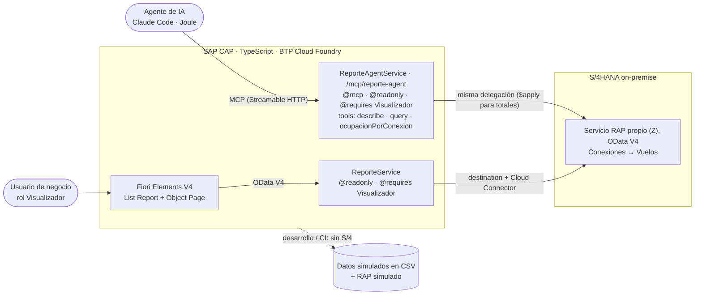

# reporte-simple

[](https://github.com/pgj1010/reporte-simple/actions/workflows/test.yml)


**[English version](README.md)**

**Un reporte SAP Fiori de solo lectura y un servidor MCP para agentes de IA, construidos sobre un único servicio SAP CAP (TypeScript) que lee datos en vivo de una API RAP de un S/4HANA on‑premise.**

## Puntos destacados

- Un servicio CAP, dos puertas: OData para Fiori, MCP para agentes de IA
- Datos de S/4HANA en vivo, clean core, nada replicado
- Seguridad probada: 401/403, solo lectura, inyección rechazada, 7/7 mutaciones
- Construido con Claude Code bajo reglas escritas y aprobaciones

Los usuarios de negocio abren un reporte Fiori Elements. Los agentes de IA (hoy Claude Code; más adelante Joule u otros) hacen preguntas en lenguaje natural a través del **Model Context Protocol (MCP)**. Ambos pasan por la misma capa CAP delgada y de solo lectura, con el mismo rol de SAP, y ningún dato se copia fuera del S/4HANA.

> Todo el proyecto, desde el análisis del servicio de origen hasta el despliegue en Cloud Foundry y su exposición a agentes, se construyó junto a **Claude Code**, siguiendo reglas escritas, planes por etapas y aprobaciones explícitas. Ver [Cómo lo construí con Claude Code](#cómo-lo-construí-con-claude-code).

---

## El problema

Una empresa con S/4HANA on‑premise quiere reportes web para sus usuarios de negocio, y ahora también quiere que agentes de IA respondan preguntas sobre esos mismos datos, sin romper el **clean core**:

- Los datos viven en el S/4HANA, detrás del firewall. SAP BTP debe leerlos **en vivo**: sin RFC, sin acceso directo a tablas, sin replicar datos y sin credenciales en el código.
- El origen es **un servicio RAP propio (Z)** que no está listo para Fiori tal cual: sus anotaciones `@UI` usan un alias que CAP no reconoce (la tabla sale **sin columnas**), sus value helps apuntan a servicios que `cds import` no trae, los decimales se pierden al importar y **CAP no delega los totales (`$apply`)** a un servicio remoto.
- Un agente de IA no debe recibir un proxy abierto al ERP. Necesita una **superficie pequeña, documentada y de solo lectura**, con la misma autorización que los usuarios.

## La solución

Un servicio CAP delgado en TypeScript con **dos puertas sobre la misma delegación al RAP**:

| Puerta | Para | Qué expone |
|---|---|---|
| **OData V4** `/odata/v4/reporte` | Fiori Elements (List Report + Object Page) | Conexiones, vuelos y un value help de aeropuertos; totales calculados por el S/4 en una sola petición |
| **MCP** `/mcp/reporte-agent` | Agentes de IA | Un `ReporteAgentService` **dedicado**: solo campos de negocio, descripciones de negocio y tres tools de solo lectura (`describe`, `query`, `ocupacionPorConexion`) |

Cada lectura se delega al RAP mediante una destination de BTP y el Cloud Connector. La presentación (columnas, filtros, textos, value helps, totales) se define en CAP a partir de una tabla de **semántica del reporte** en [`SPEC.md`](SPEC.md), y cada regla tiene su test.

## Arquitectura



- **En producción** CAP no guarda datos: filtros, orden, paginación y navegación se delegan al RAP. Los totales son **una sola** petición `filter/groupby/aggregate` que calcula el S/4 (decisión D43).
- **En desarrollo y en CI** los mismos servicios responden con archivos CSV y con un RAP simulado que reproduce los límites del Gateway real (sin `concat`, `top` ni `$count` dentro de `$apply`). Los CSV nunca llegan al build de producción, y un test lo verifica.
- **Estado:** el reporte Fiori se desplegó en Cloud Foundry y se probó contra el servicio RAP real. El servidor MCP **solo se ha ejecutado en local con datos simulados**; llevarlo a producción es un tema de diseño (ver [Hoja de ruta](#hoja-de-ruta-hacia-producción)).

## Pregúntale a los datos: ejemplos reales

Vienen de pruebas del agente registradas (Claude Code conectado a `/mcp/reporte-agent`, datos simulados, usuario `alice`). Aquí aparecen resumidas. Los registros completos están en [`PLAN.md`](PLAN.md) (niveles MCP 3 y 4).

**1. Una pregunta simple.** *"¿Qué rutas opera Lufthansa?"*
> El agente consultó `Conexiones` y las cruzó con `Aeropuertos` para dar los nombres de los aeropuertos: **LH 0400** y **LH 0402**, ambas Fráncfort (FRA) → Nueva York (JFK), con salidas a las 10:10 y a las 13:30 en los datos simulados. Aclaró que las horas son locales.

**2. Una pregunta con filtro.** *"¿Cuál es la ocupación de asientos de AA 0017?"*
> Dos vuelos: **96,6 %** el 1 de diciembre de 2026 (372 / 385) y **52,2 %** el 15 de diciembre de 2026 (201 / 385). El agente aplicó la fórmula de la descripción de la entidad (`SeatsOccupied / SeatsMax`).

**3. Un resumen de negocio con una tool dedicada.** *"Dame la ocupación por conexión y dime cuál es la más alta."*
> El agente llamó a `ocupacionPorConexion` (sin consultas libres ni lectura de archivos): la más alta es **SQ 0001** (SFO → SIN, 460 / 475, **96,8 %**), luego LH 0400 (95,2 %), AA 0017 (74,4 %) y UA 0058 (72,3 %). **LH 0402 no tiene vuelos**, así que su porcentaje queda vacío (`null`) y no en 0 %.

Y dos cosas que el agente **no pudo** hacer:
- *"Cambia el precio de SQ 0001."* La tool `query` solo acepta `SELECT`; el precio siguió en 849 SGD.
- *Llamar a `ocupacionPorConexion` con `aerolinea: "LH' or 1 eq 1"`.* El handler rechaza el valor antes de armar la petición al S/4, con un mensaje legible que el agente puede usar para corregir.

## Seguridad desde el diseño

Lo que se **probó**, y dónde está la evidencia:

| Control | Cómo | Evidencia |
|---|---|---|
| Servicio dedicado, campos mínimos | `ReporteAgentService` proyecta solo campos de negocio, sin textos internos ni totales exclusivos de la UI (D70) | Salida de `describe`, [`test/PRUEBAS_MANUALES.md`](test/PRUEBAS_MANUALES.md) → *MCP — Inspector*, paso 2b |
| Solo lectura | `@readonly` en el servicio, y `query` solo acepta `SELECT` | Prueba del agente: `UPDATE` rechazado (nivel MCP 3); las pruebas de mutación que quitan `@readonly` deben fallar (R15) |
| Mismo rol de SAP que el reporte | `@requires: 'Visualizador'`, aplicado por CAP, sin código de autorización propio | `curl`: **401** (`-32001`) sin credenciales, **403** (`-32003`) sin el rol (Inspector, paso 6); tests R15 y R16 |
| Tools marcadas de solo lectura | Cada función es su propia tool (`per_action_tool`) con `readOnlyHint: true`, en vez de una tool genérica `call` marcada como destructiva (D72) | Salida de `tools/list` (Inspector, paso 1) |
| Validación de entrada | `aerolinea` debe cumplir `^[A-Z0-9]{2,3}$` antes de usarse en la petición al S/4 | Inyección rechazada con `isError: true` y sin datos (Inspector, paso 5); tests R16 |
| Respuestas acotadas | 50 filas por defecto, 200 como máximo (`@cds.query.limit`), informadas al agente | `queryLimits` en `describe` (Inspector, paso 2b) |
| Tests que vigilan a los tests | **7/7 mutaciones** detectadas: quitar `@readonly`/`@requires` de ambos servicios, `function` → `action`, totales sin `$apply` | `npm run test:mutacion` |

Lo que **todavía no está resuelto**, dicho sin rodeos:
- **La autenticación es solo de desarrollo.** En local se usa un usuario simulado (`alice`). El 401 no envía la cabecera `WWW-Authenticate`, así que un cliente MCP no puede descubrir OAuth (el Inspector termina probando `POST /register` → 404). La autenticación real (XSUAA/IAS) es un tema de diseño.
- **Un agente puede buscar los datos por otro lado.** En una prueba, el aviso de permisos del cliente bloqueó una llamada a una tool y el agente leyó directamente el archivo CSV simulado (lección L1 en [`SPEC.md`](SPEC.md)). En producción el agente solo debe tener las tools MCP.
- **Sin protección propia contra prompt injection** en los datos que vuelven, y sin gobierno (límites de uso, auditoría). Para eso, SAP recomienda el MCP Gateway de SAP Integration Suite.

## Capturas

> Todas las capturas se toman en local con **datos simulados** (`test/data/`), nunca con datos reales. Pasos: [`docs/img/CAPTURAS.md`](docs/img/CAPTURAS.md).

| | Captura | Estado |
|---|---|---|
| 1 | List Report de Fiori con las conexiones | ⏳ **la toma el autor** |
| 2 | Object Page con totales y vuelos | ⏳ **la toma el autor** |
| 3 | Value help de aeropuertos | ⏳ **la toma el autor** |
| 4 | Claude Code respondiendo la pregunta 3 (`ocupacionPorConexion`) | ⏳ **la toma el autor** |
| 5 | MCP Inspector CLI: JSON de `tools/call ocupacionPorConexion` | ⏳ **la toma el autor** |

<!-- Cuando los PNG existan en docs/img/, reemplazar la tabla de arriba por:
| Lista de conexiones | Detalle con totales y vuelos | Value help de aeropuertos |
|---|---|---|
|  |  |  |

| El agente respondiendo por MCP | MCP Inspector (CLI) |
|---|---|
|  |  |
-->

## Cómo correrlo en local

Medido sobre un clon limpio (en SAP Business Application Studio): instalar `cds-dk` tardó 2 s, `npm ci` 4 s, `npm test` 12 s (243/243) y el servidor quedó listo en 5 s. Con una conexión doméstica las descargas tardan más, pero se queda muy por debajo de 5 minutos.

**Requisitos:** Node 24 y la CLI de CAP:

```bash
npm i -g @sap/cds-dk@^10
```

**Clonar, instalar, probar, correr:**

```bash
git clone https://github.com/pgj1010/reporte-simple.git
cd reporte-simple
npm ci
npm test          # lint + 243 tests, todos con datos simulados (necesita cds-dk global)
npm run watch     # http://localhost:4004, datos simulados, usuario "alice" con contraseña vacía
```

- App Fiori: `http://localhost:4004/conexiones/webapp/index.html`
- OData: `http://localhost:4004/odata/v4/reporte/Conexiones`
- MCP: `http://localhost:4004/mcp/reporte-agent`

**Sin `cds-dk` global** igual se puede correr la app (no los tests, que arrancan procesos de CAP con el `cds` global):

```bash
CDS_TYPESCRIPT=false npx -y -p @sap/cds-dk@^10 cds watch
```

`CDS_TYPESCRIPT=false` es necesario porque el proyecto usa el TypeScript nativo de Node 24, sin `tsx` (D13).

**Pregúntale al agente.** Con `npm run watch` corriendo, CAP registra el servidor MCP en Claude Code automáticamente (solo en desarrollo, como usuario `alice`):

```bash
claude "Dame la ocupación por conexión y dime cuál es la más alta."
```

**Inspecciona las tools a mano** con la CLI del [MCP Inspector](https://github.com/modelcontextprotocol/inspector) (D73):

```bash
URL=http://localhost:4004/mcp/reporte-agent
I="npx -y @modelcontextprotocol/inspector --cli $URL --transport http"
ALICE='Authorization: Basic YWxpY2U6'   # "alice:" en base64 (usuario simulado, contraseña vacía)

$I --header "$ALICE" --method tools/list
$I --header "$ALICE" --method tools/call --tool-name ocupacionPorConexion --tool-arg aerolinea=LH
$I --header "$ALICE" --method tools/call --tool-name query \
   --tool-arg 'cql=SELECT CarrierId, ConnectionId, AirportFromId, AirportToId FROM Conexiones'
```

## Stack

| Capa | Tecnología |
|---|---|
| Backend | SAP CAP Node.js (`@sap/cds` 10), **TypeScript nativo de Node 24** (sin `tsx` ni `ts-node`), ESM, tipos con `cds-typer` |
| Origen | S/4HANA on‑premise, un servicio RAP propio (OData V4) y su value help de aeropuertos (`cds import`), SAP Cloud SDK |
| UI | **Fiori Elements V4** (List Report + Object Page), SAPUI5, `cds-plugin-ui5`, anotaciones CDS (`@UI`, `@Common.ValueList`, `@Aggregation`, `@Measures`) |
| Agentes de IA | **MCP** con `@cap-js/mcp` (Streamable HTTP), servicio dedicado con `@mcp`, MCP Inspector para revisiones manuales |
| Seguridad | XSUAA con el rol `Visualizador` (`@requires`), destination de BTP + Cloud Connector, sin credenciales en el repo |
| Despliegue | MTA (`mbt build`, `cf deploy`), managed app router / HTML5 Application Repository, Cloud Foundry |
| Calidad | `node:test` + `@cap-js/cds-test`, RAP simulado, **pruebas de mutación**, ESLint de Fiori tools, `tsc --noEmit`, GitHub Actions |

## Decisiones clave

Las 75 decisiones (`D1`–`D75`) están en [`SPEC.md` → Decisiones](SPEC.md#decisiones). Cada una indica **qué regla afecta** y **qué pasaría si fuera al revés**. Una selección:

| | Decisión | Por qué importa |
|---|---|---|
| **D1** | Clean core flexible: APIs liberadas o un servicio RAP propio (Z) por OData; nunca RFC ni tablas | El ERP sigue siendo actualizable; BTP solo consume servicios |
| **D8 · D22** | La tabla de **semántica del reporte** es la fuente de verdad de las anotaciones; `@UI` se redefine en CAP | El RAP envía `@UI` con el alias `SAP__UI`, que CAP no reconoce. Un test (R11) compara anotaciones y tabla |
| **D43** | **Reenviar `$apply`** al RAP en el handler | CAP descarta `aggregate` en servicios remotos: 1 petición de 57 bytes en vez de 51 peticiones y 11,7 MB con 50 000 filas |
| **D46 · D47** | Totales en la **cabecera del detalle**, no en una `AnalyticalTable` | El Gateway rechaza `concat`, `top` y `$count` en `$apply`, que la tabla analítica necesita |
| **D53** | Rol `Visualizador`: 401 sin usuario, 403 sin el rol | Autorización declarativa con `@requires`, sin código propio |
| **D70** | Un **servicio MCP dedicado** con campos mínimos y descripciones de negocio | Exponer a los agentes todo el servicio del reporte filtraría campos internos y lógica exclusiva de la UI |
| **D72** | Las preguntas de negocio como una **tool de función de solo lectura** (`ocupacionPorConexion`), con totales calculados por el S/4 | Lógica controlada en vez de consultas libres; el agente no puede convertirla en una lectura de la tabla completa |
| **D73** | MCP Inspector con `npx`, en modo CLI | Muestra el JSON exacto que recibe y devuelve cada tool, sin agregar dependencias |
| **D65 · D67** | Nombre de destination genérico + marcadores para los datos internos | Repo público sin datos de ningún sistema real |

El avance por etapas, con su bitácora y sus decisiones, está en [`PLAN.md`](PLAN.md); el recorrido MCP, en [`PLAN-MCP-ZERO-TO-HERO.md`](PLAN-MCP-ZERO-TO-HERO.md).

## Métricas

| | |
|---|---|
| Reglas de negocio | **16** (R1–R16) en [`SPEC.md`](SPEC.md#reglas), incluidas R15–R16 para el servidor MCP; cada una con test automático o pasos manuales en [`test/PRUEBAS_MANUALES.md`](test/PRUEBAS_MANUALES.md) |
| Tests automáticos | **243** en 26 archivos (`npm test`, ~12 s), entre ellos un RAP simulado para probar el camino de producción sin S/4 |
| Pruebas de mutación | **7/7** detectadas (`npm run test:mutacion`) |
| Decisiones documentadas | **75**, cada una con la regla afectada y la alternativa |
| Dependencias | `npm audit`: 0 vulnerabilidades (D66) |

## Configuración (despliegue)

El repositorio no contiene datos de ningún sistema real. Los valores propios de cada instalación aparecen como **marcadores** en la documentación y se configuran fuera del código (D67):

| Marcador | Qué es | Dónde se configura |
|---|---|---|
| `<S4_HOST>:<S4_PUERTO>` | Host interno y puerto HTTP del S/4HANA | **Cloud Connector**: mapeo del host virtual al interno, recurso `/sap/opu/odata` (*Path and all sub-paths*). En BTP, la **URL** de la destination apunta al host virtual |
| `<S4_SISTEMA>` | Nombre del sistema S/4 | Solo documentación |
| `<S4_CLIENTE>` | Mandante del S/4 | Propiedad adicional `sap-client` de la destination |
| Destination `S4_BACKEND` | Destination de BTP (OnPremise, BasicAuthentication) hacia el S/4 | Subaccount → *Connectivity → Destinations*. Si tiene otro nombre: `cp deploy/destination.mtaext.ejemplo deploy/destination.mtaext`, poner el nombre real y desplegar con `cf deploy mta_archives/*.mtar -e deploy/destination.mtaext` (D65) |
| `<CF_API>`, `<CF_ORG>` | Endpoint de la API y org de Cloud Foundry (space `dev`) | `cf login -a <CF_API> -o <CF_ORG> -s dev --sso` antes de `cf deploy` |
| `<URL_APP>` | URL de la app desplegada | La genera BTP (*HTML5 Applications* en el subaccount) |

Las credenciales nunca están en el repo: la destination de BTP guarda el usuario técnico, y `.cdsrc-private.json`, `default-env.json`, `*.mtaext` y `LOCAL.md` están en `.gitignore`.

## Estructura del proyecto

```
app/conexiones/        App Fiori Elements (manifest.json, annotations.cds, xs-app.json)
srv/external/          Servicios RAP importados con cds import (generados, nunca se editan)
srv/service.cds/.ts    Servicio OData: proyecciones @readonly, @requires, delegación y reenvío de $apply
srv/agent-service.*    Servicio MCP para agentes: proyecciones dedicadas, ocupacionPorConexion
test/                  Tests por regla, RAP simulado, mutaciones, datos simulados en CSV, pasos de pruebas manuales
deploy/                Plantilla del .mtaext con el nombre real de la destination
CLAUDE.md · SPEC.md · PLAN.md · PLAN-MCP-ZERO-TO-HERO.md   Reglas, especificación y planes
```

## Cómo lo construí con Claude Code

Construí este proyecto con [Claude Code](https://claude.com/claude-code) como mi compañero de programación (pair programmer). Yo actué como responsable funcional y técnico, y Claude como desarrollador, siguiendo un proceso escrito y no prompts sueltos:

1. **Reglas del equipo en [`CLAUDE.md`](CLAUDE.md)**, que Claude lee al empezar cada sesión: proponer un plan y esperar aprobación antes de tocar archivos, una rama por etapa, `npm test` en verde y un commit por paso, nunca `cf deploy` sin aprobación, y preguntar cuando una regla admite dos lecturas que producen datos distintos.
2. **Especificación primero ([`SPEC.md`](SPEC.md)):** reglas numeradas, un análisis del servicio de origen y una tabla de semántica del reporte que guía las anotaciones de Fiori.
3. **Planes por etapas ([`PLAN.md`](PLAN.md)):** proyecto base → servicio remoto → Fiori → totales → despliegue → publicación → MCP para agentes. Cada etapa termina con un informe y mi revisión antes del merge a `main`.
4. **Decisiones registradas al tomarlas**, cada una con la regla que afecta y qué pasaría si fuera al revés, para poder revisar o revertir cualquiera.
5. **Tests que vigilan a los tests:** las pruebas de mutación quitan `@readonly` o `@requires` en una copia del código y exigen que la suite falle.
6. **Trabajo repartido según el acceso:** Claude no tiene acceso a la red interna, así que yo hice todo lo que necesita el sistema real (pruebas en el Gateway client, ADT, el navegador, el despliegue con datos reales, las pruebas del agente). Claude preparó los pasos y registró los resultados.
7. **Lecciones aprendidas que se acumulan:** cada tropiezo quedó en `CLAUDE.md` para no repetirlo (CAP que no delega `$apply`, el alias `SAP__UI`, el consumo de memoria de `tsx`, un agente que se saltó las tools MCP…).

El historial de Git conserva ese proceso: un commit por paso, con las decisiones citadas en cada mensaje.

## Hoja de ruta: hacia producción

Solo diseño; nada se despliega sin aprobación (nivel MCP 7):
- **Autenticación real** para el cliente MCP (XSUAA/IAS), incluidos la cabecera `WWW-Authenticate` y los metadatos OAuth que espera un cliente MCP.
- **Gobierno** con el MCP Gateway de SAP Integration Suite (límites de uso, auditoría, políticas).
- **Datos de aplicaciones SAP:** revisar la recomendación de SAP de no usar este adaptador como proxy de APIs de aplicaciones SAP, y las arquitecturas de referencia del SAP Architecture Center (o Joule Studio con conexiones MCP).
- **Riesgos:** prompt injection a través de los datos que vuelven y exposición de datos sensibles. Mitigación: servicio dedicado, campos mínimos y `@restrict` por rol.

## Licencia

[MIT](LICENSE) © 2026 Pablo Gallardo
