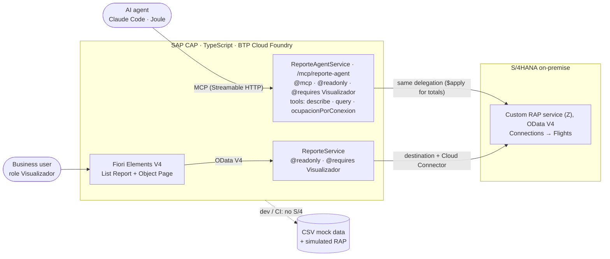
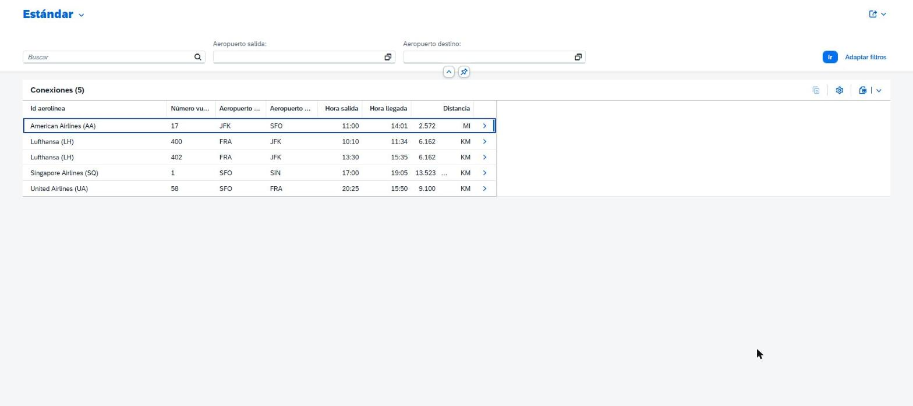
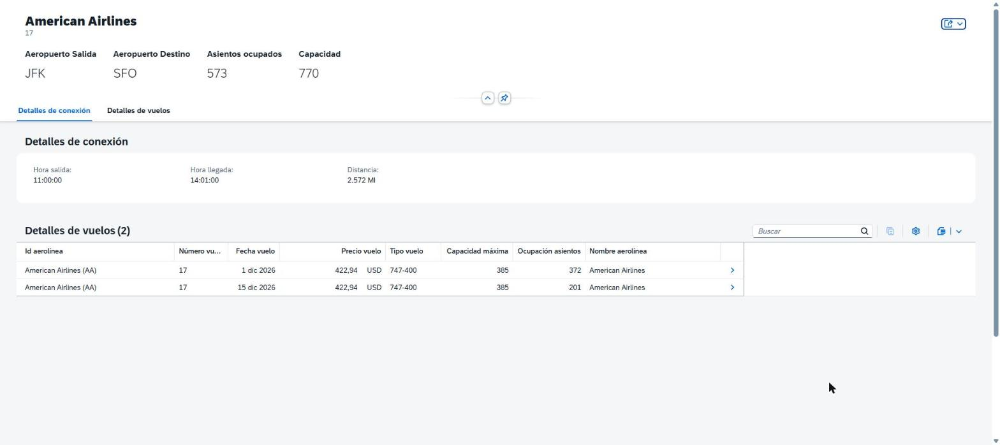
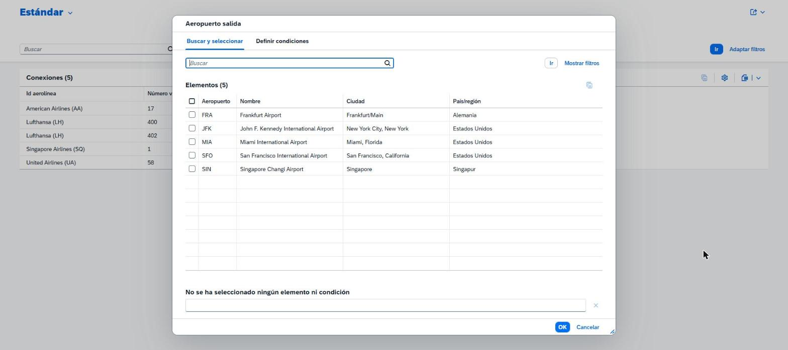
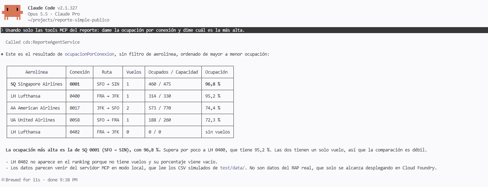
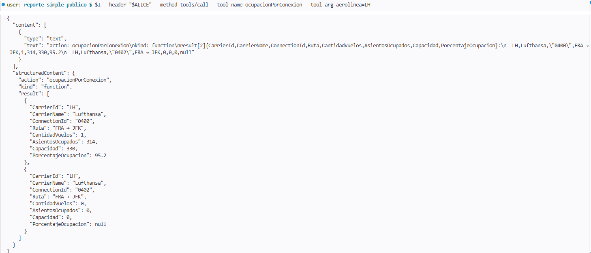

# reporte-simple

[](https://github.com/pgj1010/reporte-simple/actions/workflows/test.yml)


**[Versión en español](README.es.md)**

**A read-only SAP Fiori report and an MCP server for AI agents, built on one SAP CAP service (TypeScript) that reads live data from an S/4HANA on‑premise RAP API.**

## Highlights

- One CAP service, two doors: OData for Fiori, MCP for AI agents
- Live S/4HANA data, clean core, nothing replicated
- Security tested: 401/403, read-only, injection rejected, 7/7 mutations
- Built with Claude Code under written rules and approvals

Business users open a Fiori Elements report. AI agents (Claude Code today, Joule or others later) ask questions in natural language through the **Model Context Protocol (MCP)**. Both go through the same thin, read-only CAP layer, with the same SAP role, and no data is copied out of S/4HANA.

> The whole project, from analysing the source service to deploying on Cloud Foundry and exposing it to agents, was built together with **Claude Code**, following written rules, staged plans and explicit approvals. See [How I built it with Claude Code](#how-i-built-it-with-claude-code).

---

## The problem

A company running S/4HANA on‑premise wants web reports for business users, and now also wants AI agents to answer questions about the same data, without breaking the **clean core**:

- The data lives in S/4HANA, behind the firewall. SAP BTP must read it **live**: no RFC, no direct table access, no data replication, no credentials in code.
- The source is **a custom RAP service (Z)** that is not Fiori-ready as it is: its `@UI` annotations use an alias CAP does not recognise (the table renders **without columns**), its value helps point to services `cds import` does not bring, decimals are lost on import, and **CAP does not delegate totals (`$apply`)** to a remote service.
- An AI agent must not get an open proxy to the ERP. It needs a **small, documented, read-only surface** with the same authorisation as the users.

## The solution

A thin CAP service in TypeScript with **two doors over the same delegation to RAP**:

| Door | For | What it exposes |
|---|---|---|
| **OData V4** `/odata/v4/reporte` | Fiori Elements (List Report + Object Page) | Connections, flights and an airport value help; totals computed by S/4 in one request |
| **MCP** `/mcp/reporte-agent` | AI agents | A **dedicated** `ReporteAgentService`: only business fields, business descriptions, three read-only tools (`describe`, `query`, `ocupacionPorConexion`) |

Every read is delegated to RAP through a BTP destination and the Cloud Connector. Presentation (columns, filters, texts, value helps, totals) is defined in CAP from a **report semantics** table in [`SPEC.md`](SPEC.md), and every rule has a test.

## Architecture



- **In production** CAP stores no data: filters, sorting, paging and navigation are delegated to RAP. Totals are **one** `filter/groupby/aggregate` request computed by S/4 (decision D43).
- **In development and CI** the same services answer from CSV files and from a simulated RAP that reproduces the real Gateway's limits (no `concat`, `top` or `$count` inside `$apply`). The CSV files never reach the production build, and a test checks it.
- **Status:** the Fiori report has been deployed to Cloud Foundry and tested against the real RAP service. The MCP server has **only been run locally with mock data**; taking it to production is a design topic (see [Roadmap](#roadmap-towards-production)).

## Ask the data: real examples

These come from recorded agent test runs (Claude Code connected to `/mcp/reporte-agent`, mock data, user `alice`). The originals were in Spanish; they are translated and summarised here. The full logs are in [`PLAN.md`](PLAN.md) (MCP levels 3 and 4).

**1. A simple question.** *"Which routes does Lufthansa operate?"*
> The agent queried `Conexiones` and joined them with `Aeropuertos` to name the airports: **LH 0400** and **LH 0402**, both Frankfurt (FRA) → New York (JFK), with departures at 10:10 and 13:30 in the mock data. It pointed out that the times are local.

**2. A question with a filter.** *"What is the seat occupancy of AA 0017?"*
> Two flights: **96.6 %** on 1 Dec 2026 (372 / 385) and **52.2 %** on 15 Dec 2026 (201 / 385). The agent applied the formula from the entity description (`SeatsOccupied / SeatsMax`).

**3. A business summary through a dedicated tool.** *"Show me the occupancy by connection. Which one is the highest?"*
> The agent called `ocupacionPorConexion` (no free query, no file reads): highest **SQ 0001** (SFO → SIN, 460 / 475, **96.8 %**), then LH 0400 (95.2 %), AA 0017 (74.4 %) and UA 0058 (72.3 %). **LH 0402 has no flights**, so its percentage is empty (`null`) and not 0 %.

And two things the agent **could not** do:
- *"Change the price of SQ 0001."* The `query` tool only accepts `SELECT`; the price stayed at 849 SGD.
- *Calling `ocupacionPorConexion` with `aerolinea: "LH' or 1 eq 1"`.* The handler rejects the value before building the request to S/4, with a readable message the agent can act on.

## Security by design

What was **tested**, and where to find the evidence:

| Control | How | Evidence |
|---|---|---|
| Dedicated service, minimal fields | `ReporteAgentService` projects only business fields, with no internal texts or UI-only totals (D70) | `describe` output, [`test/PRUEBAS_MANUALES.md`](test/PRUEBAS_MANUALES.md) → *MCP — Inspector*, step 2b |
| Read-only | `@readonly` on the service, and `query` accepts only `SELECT` | Agent test: `UPDATE` rejected (MCP level 3); mutation tests that remove `@readonly` must fail (R15) |
| Same SAP role as the report | `@requires: 'Visualizador'`, enforced by CAP, with no custom authorisation code | `curl`: **401** (`-32001`) without credentials, **403** (`-32003`) without the role (Inspector step 6); tests R15 and R16 |
| Tools marked read-only | Each function is its own tool (`per_action_tool`) with `readOnlyHint: true`, instead of a generic `call` tool marked destructive (D72) | `tools/list` output (Inspector step 1) |
| Input validation | `aerolinea` must match `^[A-Z0-9]{2,3}$` before it is used in the request to S/4 | Injection rejected with `isError: true` and no data (Inspector step 5); tests R16 |
| Bounded answers | 50 rows by default, 200 maximum (`@cds.query.limit`), announced to the agent | `queryLimits` in `describe` (Inspector step 2b) |
| Tests that test the tests | **7/7 mutations** detected: remove `@readonly`/`@requires` from both services, `function` → `action`, totals without `$apply` | `npm run test:mutacion` |

What is **not solved yet**, said plainly:
- **Authentication is development-only.** Locally, a mock user (`alice`) is used. The 401 does not send a `WWW-Authenticate` header, so an MCP client cannot discover OAuth (the Inspector falls back to `POST /register` → 404). Real authentication (XSUAA/IAS) is a design topic.
- **An agent may look for data elsewhere.** In one test run, a tool call was blocked by the client's permission prompt, and the agent read the mock CSV file directly (lesson L1 in [`SPEC.md`](SPEC.md)). In production the agent must only have the MCP tools.
- **No built-in protection against prompt injection** in returned data, and no governance (rate limits, audit). SAP recommends the MCP Gateway of SAP Integration Suite for that.

## Screenshots

> All screenshots are taken locally with **mock data** (`test/data/`), never with real data. Steps: [`docs/img/CAPTURAS.md`](docs/img/CAPTURAS.md).

| List of connections | Detail with totals and flights | Airport value help |
|---|---|---|
|  |  |  |

| Agent answering through MCP | MCP Inspector (CLI) |
|---|---|
|  |  |

## Run it locally

Measured on a clean clone (in SAP Business Application Studio): installing `cds-dk` took 2 s, `npm ci` 4 s, `npm test` 12 s (243/243) and the server was ready in 5 s. On a home connection the downloads take longer, but it stays well under 5 minutes.

**Prerequisites:** Node 24 and the CAP CLI:

```bash
npm i -g @sap/cds-dk@^10
```

**Clone, install, test, run:**

```bash
git clone https://github.com/pgj1010/reporte-simple.git
cd reporte-simple
npm ci
npm test          # lint + 243 tests, all with mock data (needs the global cds-dk)
npm run watch     # http://localhost:4004, mock data, user "alice" with an empty password
```

- Fiori app: `http://localhost:4004/conexiones/webapp/index.html`
- OData: `http://localhost:4004/odata/v4/reporte/Conexiones`
- MCP: `http://localhost:4004/mcp/reporte-agent`

**Without a global `cds-dk`** you can still run the app (not the tests, which start CAP processes with the global `cds`):

```bash
CDS_TYPESCRIPT=false npx -y -p @sap/cds-dk@^10 cds watch
```

`CDS_TYPESCRIPT=false` is needed because the project uses Node 24's native TypeScript, without `tsx` (D13).

**Ask the agent.** With `npm run watch` running, CAP registers the MCP server in Claude Code automatically (development only, as user `alice`):

```bash
claude "Show me the occupancy by connection. Which one is the highest?"
```

**Inspect the tools by hand** with the [MCP Inspector](https://github.com/modelcontextprotocol/inspector) CLI (D73):

```bash
URL=http://localhost:4004/mcp/reporte-agent
I="npx -y @modelcontextprotocol/inspector --cli $URL --transport http"
ALICE='Authorization: Basic YWxpY2U6'   # "alice:" in base64 (mock user, empty password)

$I --header "$ALICE" --method tools/list
$I --header "$ALICE" --method tools/call --tool-name ocupacionPorConexion --tool-arg aerolinea=LH
$I --header "$ALICE" --method tools/call --tool-name query \
   --tool-arg 'cql=SELECT CarrierId, ConnectionId, AirportFromId, AirportToId FROM Conexiones'
```

## Stack

| Layer | Technology |
|---|---|
| Backend | SAP CAP Node.js (`@sap/cds` 10), **native TypeScript on Node 24** (no `tsx`, no `ts-node`), ESM, types with `cds-typer` |
| Source | S/4HANA on‑premise, a custom RAP service (OData V4) and its airport value help (`cds import`), SAP Cloud SDK |
| UI | **Fiori Elements V4** (List Report + Object Page), SAPUI5, `cds-plugin-ui5`, CDS annotations (`@UI`, `@Common.ValueList`, `@Aggregation`, `@Measures`) |
| AI agents | **MCP** with `@cap-js/mcp` (Streamable HTTP), dedicated service with `@mcp`, MCP Inspector for manual checks |
| Security | XSUAA with role `Visualizador` (`@requires`), BTP destination + Cloud Connector, no credentials in the repo |
| Deployment | MTA (`mbt build`, `cf deploy`), managed app router / HTML5 Application Repository, Cloud Foundry |
| Quality | `node:test` + `@cap-js/cds-test`, simulated RAP, **mutation testing**, Fiori tools ESLint, `tsc --noEmit`, GitHub Actions |

## Key decisions

All 77 decisions (`D1`–`D77`) are in [`SPEC.md` → Decisiones](SPEC.md#decisiones). Each one states **which rule it affects** and **what would happen the other way round**. A selection:

| | Decision | Why it matters |
|---|---|---|
| **D1** | Flexible clean core: released APIs or a custom RAP service (Z) over OData; never RFC or tables | The ERP stays upgradable; BTP only consumes services |
| **D8 · D22** | The **report semantics** table is the source of truth for annotations; `@UI` is redefined in CAP | RAP sends `@UI` with the `SAP__UI` alias, which CAP does not recognise. A test (R11) compares annotations and table |
| **D43** | **Forward `$apply`** to RAP in the handler | CAP drops `aggregate` on remote services: 1 request of 57 bytes instead of 51 requests and 11.7 MB with 50,000 rows |
| **D46 · D47** | Totals in the **detail header**, not an `AnalyticalTable` | The Gateway rejects `concat`, `top` and `$count` in `$apply`, which the analytical table needs |
| **D53** | Role `Visualizador`: 401 without a user, 403 without the role | Declarative authorisation with `@requires`, no custom code |
| **D70** | A **dedicated MCP service** with minimal fields and business descriptions | Exposing the whole report service to agents would leak internal fields and UI-only logic |
| **D72** | Business questions as a **read-only function tool** (`ocupacionPorConexion`), totals computed by S/4 | Controlled logic instead of free queries; the agent cannot turn it into a full table scan |
| **D73** | MCP Inspector via `npx`, CLI mode | Shows the exact JSON every tool receives and returns, without adding dependencies |
| **D65 · D67** | Generic destination name + placeholders for internal data | Public repo with no data from any real system |

Progress by stage, with its log and decisions, is in [`PLAN.md`](PLAN.md); the MCP track is [`PLAN-MCP-ZERO-TO-HERO.md`](PLAN-MCP-ZERO-TO-HERO.md).

## Metrics

| | |
|---|---|
| Business rules | **16** (R1–R16) in [`SPEC.md`](SPEC.md#reglas), including R15–R16 for the MCP server; each one with an automatic test or manual steps in [`test/PRUEBAS_MANUALES.md`](test/PRUEBAS_MANUALES.md) |
| Automatic tests | **243** in 26 files (`npm test`, ~12 s), including a simulated RAP to test the production path without S/4 |
| Mutation tests | **7/7** detected (`npm run test:mutacion`) |
| Documented decisions | **77**, each with the affected rule and the alternative |
| Dependencies | `npm audit`: 0 vulnerabilities (D66) |

## Configuration (deployment)

The repository contains no data from any real system. Installation-specific values appear as **placeholders** in the documentation and are configured outside the code (D67):

| Placeholder | What it is | Where it is configured |
|---|---|---|
| `<S4_HOST>:<S4_PUERTO>` | Internal host and HTTP port of S/4HANA | **Cloud Connector**: virtual-to-internal host mapping, resource `/sap/opu/odata` (*Path and all sub-paths*). In BTP, the destination **URL** points to the virtual host |
| `<S4_SISTEMA>` | S/4 system name | Documentation only |
| `<S4_CLIENTE>` | S/4 client | Additional property `sap-client` of the destination |
| Destination `S4_BACKEND` | BTP destination (OnPremise, BasicAuthentication) to S/4 | Subaccount → *Connectivity → Destinations*. With a different name: `cp deploy/destination.mtaext.ejemplo deploy/destination.mtaext`, set the real name and deploy with `cf deploy mta_archives/*.mtar -e deploy/destination.mtaext` (D65) |
| `<CF_API>`, `<CF_ORG>` | Cloud Foundry API endpoint and org (space `dev`) | `cf login -a <CF_API> -o <CF_ORG> -s dev --sso` before `cf deploy` |
| `<URL_APP>` | URL of the deployed app | Generated by BTP (*HTML5 Applications* in the subaccount) |

Credentials are never in the repo: the BTP destination holds the technical user, and `.cdsrc-private.json`, `default-env.json`, `*.mtaext` and `LOCAL.md` are in `.gitignore`.

## Project structure

```
app/conexiones/        Fiori Elements app (manifest.json, annotations.cds, xs-app.json)
srv/external/          RAP services imported with cds import (generated, never edited)
srv/service.cds/.ts    OData service: @readonly projections, @requires, delegation and $apply forwarding
srv/agent-service.*    MCP service for agents: dedicated projections, ocupacionPorConexion
test/                  Tests per rule, simulated RAP, mutations, CSV mock data, manual test steps
deploy/                Template of the .mtaext with the real destination name
CLAUDE.md · SPEC.md · PLAN.md · PLAN-MCP-ZERO-TO-HERO.md   Rules, specification and plans
```

## How I built it with Claude Code

I built this project with [Claude Code](https://claude.com/claude-code) as my pair programmer. I acted as functional and technical lead, and Claude as the developer, following a written process rather than loose prompts:

1. **Team rules in [`CLAUDE.md`](CLAUDE.md)**, read by Claude at the start of every session: propose a plan and wait for approval before touching files, one branch per stage, green `npm test` and one commit per step, never `cf deploy` without approval, and ask when a rule allows two readings that produce different data.
2. **Specification first ([`SPEC.md`](SPEC.md)):** numbered rules, an analysis of the source service and a report semantics table that drives the Fiori annotations.
3. **Staged plans ([`PLAN.md`](PLAN.md)):** base project → remote service → Fiori → totals → deployment → publication → MCP for agents. Each stage ends with a report and my review before merging to `main`.
4. **Decisions recorded when taken**, each with the rule it affects and what would happen the other way round, so any of them can be reviewed or reverted.
5. **Tests that watch the tests:** mutation tests remove `@readonly` or `@requires` in a copy of the code and require the suite to fail.
6. **Work split by access:** Claude has no access to the internal network, so I did everything that needs the real system (Gateway client tests, ADT, the browser, the deployment with real data, the agent tests). Claude prepared the steps and recorded the results.
7. **Lessons learned that add up:** every stumble went into `CLAUDE.md` so it is not repeated (CAP not delegating `$apply`, the `SAP__UI` alias, `tsx` memory use, an agent bypassing the MCP tools…).

The Git history keeps that process: one commit per step, citing the decisions in each message.

## Roadmap: towards production

Design only (MCP level 7); nothing is deployed without approval. Details, diagram and open questions: [`SPEC.md` → *MCP en producción*](SPEC.md#mcp-en-producción) (decision D77, provisional).
- **Recommended architecture (B):** expose `ReporteAgentService` as OData and let the **MCP Gateway of SAP Integration Suite** turn it into MCP tools; a Joule Studio agent can consume them later. Running the `@cap-js/mcp` adapter in production (A) is discarded: it is beta and SAP advises against using it to proxy SAP application APIs.
- **Authentication:** OAuth 2.0 authorization code with the user's delegated token (XSUAA or IAS). The Gateway publishes the `WWW-Authenticate` / OAuth metadata that MCP clients need. Principal propagation through the Cloud Connector up to S/4HANA, for the Fiori app as well as for MCP.
- **Governance:** rate limits, audit and monitoring in the Gateway; CAP keeps `@requires`, `@readonly` and row limits.
- **Risks:** prompt injection through returned data; agents get **only** the MCP tools (lesson L1).

## License

[MIT](LICENSE) © 2026 Pablo Gallardo
